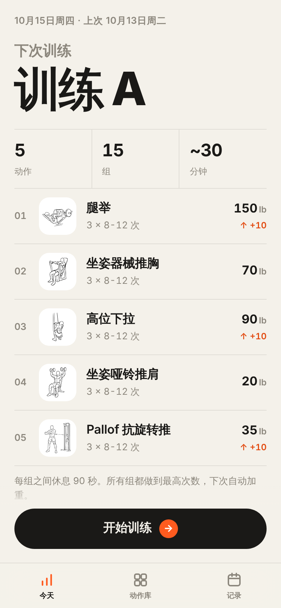
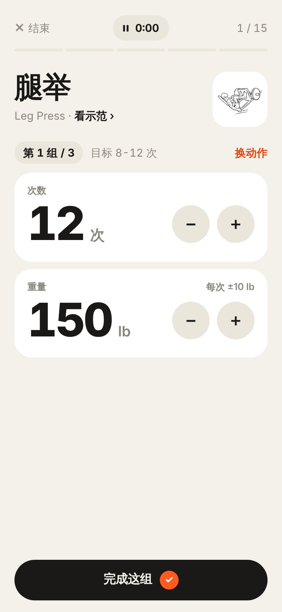
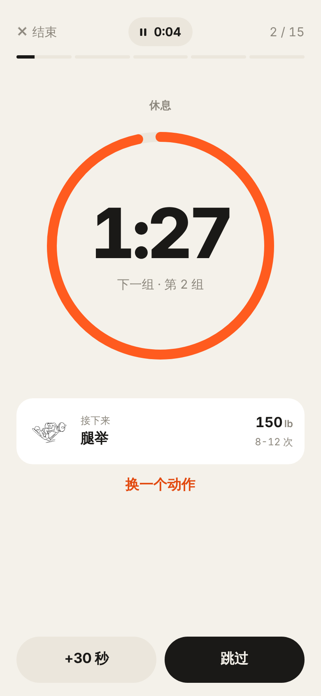

# 健身

给力量训练新手用的网页 app：每次打开告诉你今天练什么、每个动作用多重，练的时候帮你记组数、数休息时间，练完自动安排下次加重。

在 iPhone 上添加到主屏幕使用：**https://ym820.github.io/personal-fitness-app/**

<p>
  
  
  
</p>

## 功能

- **训练计划**：A、B 两套全身训练交替，每套 5 个动作 × 3 组，以器械和哑铃为主
- **自动加重**：一个动作所有组都做到目标次数的上限，下次自动加一档重量
- **训练中**：次数和重量已经预填好，点一下完成一组；组间休息倒计时，可以加时、跳过、暂停；器械被占可以先换别的动作；屏幕常亮
- **动作库**：每个动作有起止姿势示范图、动作要点和示范视频（YouTube / B 站）
- **记录**：历史训练、每组的次数和重量，可选同步到自己的 GitHub 私有仓库
- **离线可用**：装到主屏幕后没网也能练，数据存在手机上

心率和卡路里可以同时用 Apple Watch 自带「体能训练」里的「传统力量训练」记录。

## 使用

### 装到 iPhone 主屏幕

1. 用 Chrome 打开上面的网址，点地址栏右边的分享按钮 →「添加到主屏幕」
2. 以后都从主屏幕图标打开。主屏幕 app 和浏览器标签页的数据不互通

更新：部署新版本后，把 app 从后台划掉再打开，可能要重复一两次才会加载新版本。

### 同步训练记录到 GitHub（可选）

记录默认只存在这台手机上。填了令牌后会在打开 app、练完、点「立即同步」时同步到你自己的私有仓库里的 `workouts.json`，换手机时同步一次就能拉回全部记录。

1. 在 GitHub 新建私有仓库 `fitness-data`，勾选「Add a README file」
2. 生成令牌：GitHub → Settings → Developer settings → Personal access tokens → Fine-grained tokens → Generate new token
   - Repository access 选 Only select repositories → `fitness-data`
   - Permissions → Repository permissions → Contents 选 Read and write
3. 在 app 里「记录 → 设置」填仓库（`你的用户名/fitness-data`）和令牌，点「保存并同步」

令牌只存在手机上，只能读写这一个仓库。过期后 app 会提示「令牌无效或已过期」，重新生成一个填进去；手机丢了的话去 GitHub 删掉这个令牌。

## 开发

纯 HTML / CSS / JavaScript（ES modules），没有编译步骤，也没有 npm 依赖。需要 Node 22 和 Python 3。

```sh
scripts/build_web.sh                     # 组装网站到 _site/
python3 -m http.server 8000 -d _site     # 打开 http://localhost:8000/

node --test web/test/*.test.js           # 单元测试
python3 scripts/validate_data.py         # 检查动作、计划、视频数据
```

推送到 `main` 后，GitHub Actions（[`pages.yml`](.github/workflows/pages.yml)）跑测试、组装 `_site/` 并发布到 GitHub Pages。

### 目录

```
web/                    网页 app
  js/views/             各个页面：今天、训练中、动作库、记录、设置
  js/flow.js            一次训练的流程：做组 → 休息 → 下一组
  js/plan.js            下次练哪套、用多重
  js/sync.js            同步到 GitHub
  sw.js                 离线缓存
  test/                 单元测试
Packages/FitnessCore/Sources/FitnessCore/Resources/
  exercises.json        动作：中英文名、器械、要点、加重档位
  plan.json             训练计划：A、B 两套，每个动作几组、目标次数
  videos.json           示范视频链接
FitnessApp/Assets.xcassets/ExerciseImages/   动作示范图（SVG）
scripts/                组装网站、检查数据、下载示范图
docs/superpowers/       设计文档和实现计划
FitnessApp/ FitnessWatch/ project.yml   原 iOS + Apple Watch 版（已停更）
```

动作数据和示范图放在 iOS 版的目录里，网页版组装时直接拷过去用，所以位置看起来有点绕。

<details>
<summary>示范视频的格式</summary>

`videos.json` 只存链接，播放时需要联网，没有填视频的动作不显示这一块。

```json
{
  "Leg_Press": [
    {
      "platform": "youtube",
      "id": "视频 id（watch?v= 后面那串）",
      "title": "视频标题",
      "author": "作者",
      "durationSeconds": 48,
      "embeddable": true
    }
  ],
  "Goblet_Squat": [
    {
      "platform": "bilibili",
      "id": "BV 号",
      "title": "视频标题",
      "author": "UP 主",
      "durationSeconds": 95,
      "embeddable": true,
      "thumbnail": "封面图地址（B 站要填，YouTube 不用）"
    }
  ]
}
```

- 键是 `exercises.json` 里的动作 id，每个动作 1 到 2 个视频，尽量来自同一个作者，保持风格统一
- `embeddable` 为 false 时，点卡片直接跳到 YouTube / B 站 app；省略时默认为 true
- 改完运行 `python3 scripts/validate_data.py` 检查

</details>

<details>
<summary>原 iOS + Apple Watch 版（已停更）</summary>

最早做的是 SwiftUI 写的 iPhone + Apple Watch app，后来换成了网页版。代码还在仓库里，不再更新。

在 Mac 上构建：

```sh
brew install xcodegen   # 第一次
xcodegen                # 每次拉完代码
open FitnessApp.xcodeproj
```

`FitnessApp.xcodeproj` 由 `project.yml` 生成，不进 git，工程设置改 `project.yml`。签名在 `FitnessApp` 和 `FitnessWatch` 两个 target 的 Signing & Capabilities 里选自己的 Apple ID，或者把 Team ID 填到 `project.yml` 的 `DEVELOPMENT_TEAM`。

核心逻辑的测试不需要 Xcode，Mac 或 Linux 上都能跑：

```sh
cd Packages/FitnessCore && swift test
```

</details>

## 素材来源

- 动作示范图：[Workout Guide](https://github.com/bryllim/workout-guide)，作者 Bryl Lim，基于 [Everkinetic](https://github.com/everkinetic/data)，[CC BY-SA 4.0](https://creativecommons.org/licenses/by-sa/4.0/)。改动：裁掉了画布四周的空白（只改 SVG 的 viewBox），在 app 里按系统颜色染色，线条本身未改。改动后的图片同样按 CC BY-SA 4.0 授权。每个动作用哪两帧见 `scripts/workout_guide_frames.json`，重新下载用 `python3 scripts/fetch_images.py`。
- 动作列表和英文说明：[free-exercise-db](https://github.com/yuhonas/free-exercise-db)（Unlicense）。中文名和动作要点根据它的英文说明翻译精简。
- 示范视频：链接到 YouTube 和 B 站上的原视频，版权归原作者。

## 许可证

代码按 [MIT](LICENSE) 授权。动作示范图按 CC BY-SA 4.0 授权（见上面「素材来源」），不在 MIT 范围内。
